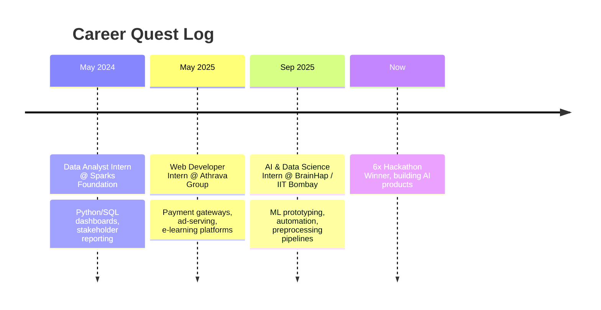

<div align="center">

<!-- ═══════════════ HERO ═══════════════ -->


<a href="https://git.io/typing-svg">
  
</a>

<br/>


<br/><br/>

[](https://linkedin.com/in/mayankbereal1)
[](https://mayank-kenshin-portfolio.vercel.app/)
[](mailto:mayankbereal1@gmail.com)
[](https://github.com/ImpactG1)


<!-- ═══════════════ NAV ═══════════════ -->
<br/>

**[ [About](#-about) ]** · **[ [Wanted](#-wanted-poster) ]** · **[ [Skills](#-skill-tree) ]** · **[ [Journey](#-the-journey) ]** · **[ [Stats](#-stats) ]** · **[ [Memes](#-meme-vault) ]** · **[ [Contact](#-contact) ]**

</div>


## 🧠 About


```python
class MayankBhuvad:
    role      = "Data Scientist & AI Engineer"
    education = "B.Sc. Data Science, University of Mumbai (9.3 CGPA)"
    based_in  = "Mumbai, India"
    wins      = {"hackathons": 6, "ideathons": 1}
    passions  = ["NLP", "Deep Learning", "Full-Stack AI Apps"]

    def current_focus(self):
        return [
            "Fine-tuning LLMs for low-resource Indian languages",
            "Production-grade AI REST APIs",
            "Reinforcement Learning & AI Agents",
        ]

    def philosophy(self):
        return "Ship it. Measure it. Fix it. Ship it again."
```

I build AI products end to end: model, API, frontend, deploy. I like problems where the data is messy and the stakes are real.

<br clear="right"/>

---

## 🏴‍☠️ Wanted Poster

<div align="center">

```
╔══════════════════════════════════════════════════╗
║                                                  ║
║                  W A N T E D                     ║
║               ── DEAD OR SHIPPED ──              ║
║                                                  ║
║              MAYANK  "THE 2AM"  BHUVAD          ║
║                                                  ║
║   CRIMES:  Winning 6 hackathons                  ║
║            Fine-tuning models for fun            ║
║            Pushing to main on Friday             ║
║                                                  ║
║   LAST SEEN:  Mumbai, debugging                  ║
║   WEAPON OF CHOICE:  Python + caffeine           ║
║                                                  ║
║   BOUNTY:  ₿ 1 good problem to solve             ║
║                                                  ║
╚══════════════════════════════════════════════════╝
```

</div>

---

## 🏆 Trophy Room

<div align="center">

| 🏆 | 💡 | 🌍 | 🐍 | 🎓 |
|:---:|:---:|:---:|:---:|:---:|
| **6x Hackathon Winner** | **1x Ideathon Winner** | **Top 1000** | **Python Champion** | **9.3 CGPA** |
| National & International | Creative Problem Solving | Google Hackathon | College Level | B.Sc. Data Science |


</div>

---

## 🌳 Skill Tree

<div align="center">

**🤖 AI / ML / Data**<br/>
 

**🌐 Full-Stack**<br/>


**🗄️ Data & DevOps**<br/>


**🔧 Also**<br/>


<br/>

| Skill | Level |
|:---|:---|
| NLP & LLM fine-tuning | `█████████░` |
| Python / data pipelines | `██████████` |
| Full-stack web apps | `█████████░` |
| Reinforcement Learning | `█████░░░░░` |
| Sleep schedule | `░░░░░░░░░░` |

</div>

---

## 🚀 The Journey



<details>
<summary><b>📂 Expand the full experience log</b></summary>

<br/>

| Role | Org | Period | Highlights |
|:---|:---|:---|:---|
| AI & Data Science Intern | BrainHap / IIT Bombay | Sep 2025 – Jan 2026 | ML model prototyping, automation scripts, data preprocessing pipelines |
| Web Developer Intern | Athrava Group | May – Jul 2025 | Full-stack dev, payment gateways, ad-serving, e-learning platforms |
| Data Analyst Intern | Sparks Foundation | May 2024 – Jul 2025 | Python/SQL dashboards, statistical insights, stakeholder reporting |

</details>

---

## 🛰️ Mission Log

| | Mission | Progress |
|:---:|:---|:---|
| ✅ | Fine-tune multilingual NLP models for Indian code-mixed text | `██████████` |
| ✅ | Win 6 hackathons (national & international) | `██████████` |
| ✅ | Ship an end-to-end AI product (REST API + React) | `██████████` |
| 🔄 | Deploy a production-scale AI SaaS product | `██████░░░░` |
| 🔄 | Contribute to open-source NLP / ML | `████░░░░░░` |
| 🔄 | Master Reinforcement Learning & AI agents | `████░░░░░░` |
| ⏳ | Publish research on Hinglish toxicity detection | `██░░░░░░░░` |
| ⏳ | Land a full-time AI/ML role and keep building | `███░░░░░░░` |
| 👑 | Hackathon #7 (the prophecy) | `░░░░░░░░░░` |

---

## 📊 Stats

<div align="center">


<br/>

<!-- Needs the snake workflow in .github/workflows/snake.yml -->


</div>

---

## 😂 Meme Vault

<div align="center">

<table>
  <tr>
    <td align="center" width="33%">
      <br/>
      <b>Me explaining my ML model</b>
    </td>
    <td align="center" width="33%">
      <br/>
      <b>When the model finally converges</b>
    </td>
    <td align="center" width="33%">
      <br/>
      <b>Submitting at 11:59 PM</b>
    </td>
  </tr>
  <tr>
    <td align="center" width="33%">
      <br/>
      <b>Debugging at 3 AM</b>
    </td>
    <td align="center" width="33%">
      <br/>
      <b>When it works on the first try</b>
    </td>
    <td align="center" width="33%">
      <br/>
      <b>After hackathon #6 🏆</b>
    </td>
  </tr>
</table>

<br/>

```
┌─────────────────────┬─────────────────────┬─────────────────────┐
│ "Works on my        │ Training loss: NaN  │ Fixed one bug,      │
│  machine"           │                     │  made three more    │
├─────────────────────┼─────────────────────┼─────────────────────┤
│ git commit -m       │   ★ FREE SPACE ★    │ 99% accuracy        │
│  "final_final_v2"   │  Won a hackathon    │  (on the train set) │
├─────────────────────┼─────────────────────┼─────────────────────┤
│ "5 min task"        │ Wrote the demo      │ Stack Overflow      │
│  (4 hours later)    │  the night before   │  saved my life      │
└─────────────────────┴─────────────────────┴─────────────────────┘
                    DEV MEME BINGO
```

<br/>
<i>"AI can't do that." Me, shipping a prototype in 24 hours. 😤⚡</i>

</div>

---

## 🕶️ Words to Build By

<div align="center">


### *"Always believe in yourself, who believes in you.."*
**Kamina**, *Tengen Toppa Gurren Lagann*

<sub>Drill-powered by Spiral Energy. Hackathon-powered by caffeine.</sub>

</div>

---

## 🤝 Contact

<div align="center">

<i>I love connecting with fellow builders, dreamers and hackers.<br/>Hiring, collaborating, or just want to talk models? My inbox is open.</i>

<br/><br/>

[](https://linkedin.com/in/mayankbereal1)
[](mailto:mayankbereal1@gmail.com)
[](https://mayank-kenshin-portfolio.vercel.app/)

<br/>


</div>

<!---
ImpactG1/ImpactG1 is a ✨ special ✨ repository because its `README.md` (this file) appears on your GitHub profile.
--->
